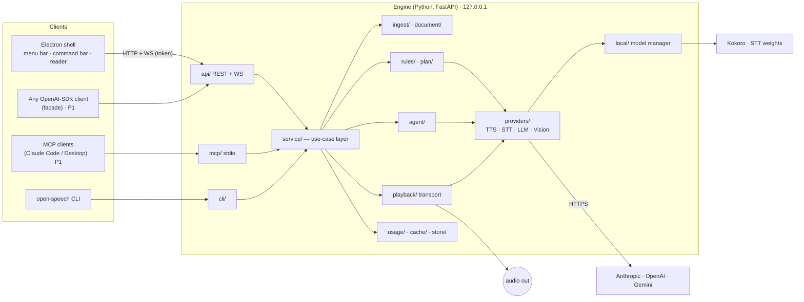

# 03 — Architecture

Status: Draft v0.1 · 2026-11-21

## Shape



**Target platform:** macOS 14+ on Apple Silicon only, for now (NFR-6).

**Rules of the shape**
1. All behavior lives in `service/`. The three surfaces (`api/`, `mcp/`, `cli/`) are thin adapters with no logic of their own.
2. The shell is a client. It renders, captures the mic, draws highlights and relays hotkeys. It holds no keys and no business logic.
3. Providers sit behind protocols. Nothing outside `providers/` imports a vendor SDK.
4. The engine owns playback: there is one transport, and every surface controls the same session.

## Engine (`engine/`)

**Runtime:** Python 3.13 or 3.14, whichever newest version has wheels for every pinned dependency at scaffold time (3.14 preferred, to match aden). Managed with uv.

| Concern | Choice | Notes |
|---|---|---|
| HTTP / WS | FastAPI + uvicorn | OpenAPI generated and committed |
| Models / config | pydantic v2, pydantic-settings | `.env` anchored at repo root, `SecretStr` (pattern: `aden/aden/config.py`) |
| Claude | `anthropic` | Messages API + Tool Runner (`@beta_tool`); structured outputs for span ops |
| OpenAI | `openai` | TTS (`audio.speech`), STT (transcriptions, realtime) |
| Gemini | `google-genai` ≥ 2.25 | TTS via the **Interactions API** (`client.interactions.create`, `api_version=v1beta`) |
| HTTP utils | httpx, tenacity | Retries with jittered backoff |
| Storage | SQLite (stdlib `sqlite3`) + a thin repository layer | WAL mode; one file in app data |
| Frontmatter | pyyaml | Rules and skills |
| PDF | pypdfium2 + pdfplumber | Char boxes, fonts, layout. **Not PyMuPDF (AGPL)** |
| Web (headless) | trafilatura | Used when no shell provides DOM blocks |
| DOCX | python-docx | |
| Media | PyAV | Audio-file decode (P1) |
| Audio I/O | sounddevice + soundfile | Playback, recording, Ogg/Opus |
| Speed | audiotsm (WSOLA) | Pitch-preserving time-stretch in the transport |
| Secrets | keyring | OS keychain in packaged builds |
| CLI | Typer | |
| MCP | `mcp` SDK | stdio server (P1); entry pattern like `aden/mcp_main.py` |
| Quality | ruff, mypy `--strict`, pytest + pytest-asyncio | Same as aden |

**Optional extras** (installed on demand by the model manager):
- `local-kokoro`: onnxruntime + Kokoro timestamped ONNX. In the default install for packaged builds.
- `local-qwen` (P2): mlx-audio on Apple Silicon, preset voices only.
- `local-stt`: sherpa-onnx with Moonshine v2 / Parakeet TDT v3.
- `local-align`: Qwen3-ForcedAligner-0.6B (v1.1).

### Package layout

```
engine/src/open_speech/
  api/          routers (REST), ws.py (event protocol), auth.py (token, Host/Origin)
  mcp/          server.py (P1)
  cli/          main.py (Typer)
  service/      documents.py, playback.py, rules.py, assistant.py, usage.py, voices.py, settings.py, models.py
  ingest/       pdf.py, html_blocks.py, url.py, docx.py, text.py, image.py, audio.py (P1)
  document/     model.py (Block, Mark, Document), segment.py (sentences, words, offsets)
  rules/        files.py (load/watch), presets/, compiler.py, filters.py, lexicon.py, skills.py
  plan/         planner.py, annotate.py (Claude span ops), transform.py, script.py (Utterance)
  agent/        core.py (tool runner), tools/, intents.py (fast path), prompts/
  playback/     transport.py, stretch.py, output.py, timing.py
  providers/    base.py (protocols), openai_tts.py, gemini_tts.py, kokoro.py, qwen3.py (P2),
                openai_compatible.py, openai_stt.py, gemini_stt.py, anthropic_llm.py
  local/        manager.py (download, sha256, hardware probe, remove), catalog.py
  usage/        ledger.py, pricing.py, budget.py, estimate.py
  cache/        audio.py, plans.py, extract.py, keys.py
  store/        db.py, migrations/, repositories.py
  config.py     Settings (pydantic-settings)
  data/         models.toml, pricing.toml, presets/*.md, skills/*
```

## Shell (`app/`)

| Concern | Choice |
|---|---|
| Build | electron-vite |
| UI | React 19 + `babel-plugin-react-compiler`, TypeScript strict |
| Styling | Tailwind CSS v4, shadcn/ui (Radix), lucide icons; the command bar is shadcn `Command` (cmdk) |
| State | Zustand (UI-only state); server state comes from the engine |
| Engine client | `openapi-typescript` + `openapi-fetch` generated from the committed OpenAPI; typed WS client generated from the event schema |
| PDF render | pdf.js (`pdfjs-dist`) |
| Web render | `WebContentsView` with partition `persist:web` |
| Packaging | electron-builder, macOS arm64 only |
| Tests | Vitest, Playwright `_electron` |

**App windows (3, nothing else):**
1. **Tray / menu bar.** Always present; reflects state.
2. **Command bar.** Frameless, transparent, vibrancy on macOS, centered; created hidden at startup so it appears ≤ 150 ms after the hotkey.
3. **Reader.** Opens on demand for PDFs, web pages and images. Content only, plus a thin title strip.

**Main-process duties:** register global shortcuts and media keys; supervise the engine; route OS file and URL opens to the engine; set permissions (mic only for the command bar renderer); open external links in the OS browser.

### Engine supervision

1. The shell spawns `open-speech serve --port 0 --handshake stdout` using the bundled uv-managed runtime (packaged) or `uv run` (dev).
2. The engine binds `127.0.0.1:<random>`, generates a 256-bit token, writes `engine.json` (0600) and prints a JSON handshake line `{port, token, version, pid}`.
3. The shell health-checks `/api/v1/health` every 5 s and restarts the engine with backoff on failure. The engine restores the transport from its last persisted state.
4. Standalone CLI use: `open-speech read x.pdf` reuses a running engine found through `engine.json`, or starts an ephemeral one.

## Highlighting paths

| Source | Who extracts | Anchor type | How the highlight is drawn |
|---|---|---|---|
| PDF | Engine (pypdfium2 / pdfplumber) | `{blockId, charStart, charEnd}` + word bboxes in PDF points | Reader overlays rectangles on the pdf.js viewport (transform points → CSS px) |
| Web page (shell open) | Page preload runs Readability.js in-page and posts blocks with DOM anchors (XPath + text offsets) | `{blockId, domAnchor}` | Preload maps the anchor to a DOM `Range` and paints it with the CSS Custom Highlight API (no DOM mutation) |
| Web page (headless) | Engine (trafilatura) | `{blockId, charStart, charEnd}` | Reader shows extracted text; no live-page highlight |
| DOCX / TXT / MD / paste | Engine | `{blockId, charStart, charEnd}` | Reader renders blocks as text and highlights spans |
| Image | Engine → Claude vision | `{imageId, bbox?}` or none | Optional region outline; otherwise the image plus transcript |
| Audio file (P1) | Engine (PyAV decode + STT) | `{mediaTime: [t0, t1]}` | Reader shows the transcript and seeks the audio |

Fidelity degrades gracefully: `exact` → `block` → `section` → `media`. The reader always shows *something*: at minimum the current block or section is outlined.

## Playback transport

- A single session: queue of utterances, position (utterance + offset ms), speed, voice, state.
- **Pipeline:** utterance audio (from cache or provider stream) → decode → WSOLA stretch at the current speed → sounddevice output.
- **Events** (WS): `playback.state` on every state change, and `playback.word` at word boundaries (from timestamps or estimates).
- **Prefetch:** keep ~30 s of audio ahead synthesized and cached; never synthesize more than 2 minutes ahead unless "keep offline" is set (bounds cost when the user stops).
- **Ducking:** when the assistant speaks, the transport pauses the reading and resumes it exactly afterwards.
- **Persistence:** position saved every 5 s and on pause/stop.

## Storage (app data)

`~/Library/Application Support/OpenSpeech/` (paths come from `platformdirs`, so other OSes remain possible later). Override with `OPEN_SPEECH_HOME`.

```
db.sqlite                 documents, blocks, plans, utterances, ledger, settings, recents, positions
cache/audio/ab/cd/<sha256>.ogg
cache/extract/<sha256>.json.zst
recordings/<yyyy-mm-dd>/<id>.ogg      (retention, default 30 days)
rules/SPEECH.md
rules/lexicon.csv
rules/*.md                presets are copied here on first run and are user-editable
skills/<name>/SKILL.md    (P1)
models/<provider>/<model>/            local weights (sha256-verified)
models.toml               user overrides merged over the bundled catalog
pricing.toml              user overrides merged over the bundled pricing
settings.toml             shortcuts, defaults, budget, retention, modes
engine.json               {port, token, pid} — mode 0600, deleted on clean exit
logs/engine.log           rotating, local only
```

Rules, skills, settings and catalogs are **plain files** on purpose: users can version them, share them and edit them by hand. The engine watches them and reloads on change.

## Security

| Threat | Mitigation |
|---|---|
| Another local process or a web page calls the engine | Bind 127.0.0.1 only; bearer token on every REST and WS call; check `Host` is `127.0.0.1:<port>`/`localhost:<port>`; reject browser `Origin`s other than the shell's custom `app://` origin; no permissive CORS |
| Key exfiltration | Keys live only in the engine (env in dev, keychain in packaged builds); `PUT /keys/{provider}` is write-only; keys are never logged (SecretStr); the shell never receives them |
| Malicious web content in the reader | `WebContentsView` with its own partition, `sandbox: true`, `contextIsolation: true`, no `nodeIntegration`; a minimal preload exposing only "post blocks" and "paint highlight"; permission requests denied by default; downloads prompt |
| Shell renderer compromise | Strict CSP; no remote code; IPC validated with schemas; the renderer gets only the engine token, and only for the command bar and reader windows |
| Prompt injection via documents | See `07` § Injection boundary: content is data; plan and vision calls have no tools; mutating agent actions need user confirmation |
| Supply chain | Lockfiles (`uv.lock`, `pnpm-lock.yaml`) committed; local model weights pinned by sha256 in the catalog |
| Accidental spend | Budget hard stop; pre-flight estimates; prefetch caps (see `08`) |
