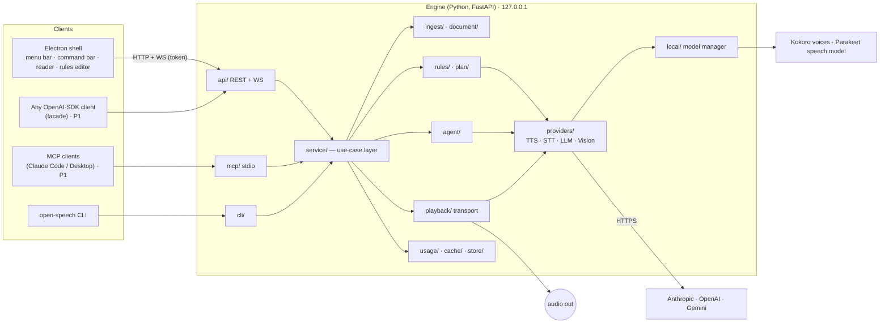

# 03 — Architecture

Status: Draft v0.1 · 2026-11-22

## Shape



**Target platform:** macOS 14+ on Apple Silicon only, for now (NFR-6).

**Rules of the shape**
1. All behavior lives in `service/`. The three surfaces (`api/`, `mcp/`, `cli/`) are thin adapters with no logic of their own.
2. The shell is a client. It renders, captures the mic, draws highlights, relays hotkeys and looks up files for the `@` menu. It holds no keys and no business logic.
3. Providers sit behind protocols. Nothing outside `providers/` imports a vendor SDK.
4. The engine owns playback: there is one transport, and every surface controls the same session.

## Engine (`engine/`)

**Runtime:** Python 3.13 or 3.14, whichever newest version has wheels for every pinned dependency at scaffold time (3.14 preferred, to match aden). Managed with uv.

| Concern | Choice | Notes |
|---|---|---|
| HTTP / WS | FastAPI + uvicorn | OpenAPI generated and committed |
| Models / config | pydantic v2, pydantic-settings | Environment, then `provider.env` in a packaged runtime, then `.env` at the repo root; keys are `SecretStr` (`08` § Keys) |
| Claude | `anthropic` | Messages API + Tool Runner (`@beta_tool`); structured outputs for span ops |
| OpenAI | `openai` | TTS (`audio.speech`), STT (transcriptions, realtime) |
| Speech-to-text (local) | sherpa-onnx (`local-stt` extra) | Parakeet TDT 0.6B v3 with a Silero VAD gate; the default for the command bar (`08` § Local speech-to-text) |
| Gemini | `google-genai` ≥ 2.25 | TTS via the **Interactions API** (`client.interactions.create`, `api_version=v1beta`) |
| HTTP utils | httpx, tenacity | Retries with jittered backoff. Every URL the engine reads goes through the page store (`store/pages.py`), which also enforces the network boundary |
| Storage | SQLite (stdlib `sqlite3`) | WAL mode; one file in app data. Files worth keeping (voice audio, transcripts, fetched pages) live in the content-addressed asset store, indexed in SQLite |
| Text | `open_speech.i18n` | Everything the engine says or shows comes from two catalogs (English, Spanish) with identical keys; a task can answer in another language than the default |
| Frontmatter | pyyaml | Rules and skills |
| PDF | pypdfium2 + pdfplumber | Char boxes, fonts, layout. **Not PyMuPDF (AGPL)** |
| Web (headless) | trafilatura | Used when no shell provides DOM blocks |
| DOCX | python-docx | |
| Media | PyAV | Audio-file decode (P1) |
| Audio I/O | sounddevice + soundfile | Playback, recording, Ogg/Opus |
| Speed | audiotsm (WSOLA) | Pitch-preserving time-stretch in the transport |
| CLI | Typer | |
| MCP | `mcp` SDK | stdio server (P1); entry pattern like `aden/mcp_main.py` |
| Quality | ruff, mypy `--strict`, pytest + pytest-asyncio | Same as aden |

**Optional extras** (installed on demand by the model manager):
- `local-kokoro`: onnxruntime + Kokoro timestamped ONNX, with the English lexicon G2P (misaki) and the built-in Spanish G2P. In the default install for packaged builds.
- `local-stt`: sherpa-onnx, which runs Parakeet TDT 0.6B v3 and Silero VAD. In the default install for packaged builds.
- `mcp`: the MCP SDK for the stdio server.
- Planned, not in `pyproject.toml` yet: `local-qwen` (P2; mlx-audio on Apple Silicon, preset voices only) and `local-align` (v1.1; Qwen3-ForcedAligner-0.6B).

### Package layout

```
engine/src/open_speech/
  api/          app.py (FastAPI app, WebSocket), routes.py (REST), schemas.py, ws_schema.py (event protocol),
                auth.py (token, Host/Origin), export.py (writes openapi.json and ws-schema.json)
  mcp/          server.py
  cli/          main.py (Typer)
  service/      engine.py (wiring, capabilities), documents.py, playback.py (transport + reading queue),
                rules.py (rules, presets, lexicon, rule files), assistant.py (turns, attachments, action cards),
                commands.py (what each fast-path command does), voice_input.py (mic sessions), settings.py,
                clipboard.py, misc.py (voices, usage, models, recordings), events.py
  ingest/       pdf.py, html_blocks.py, url.py, lead.py (side material after the lead), docx.py, text.py,
                image.py, marks.py
  document/     model.py (Block, Mark, Document), segment.py (sentences, words, offsets; English and
                Spanish rules), language.py (which language a document is in)
  rules/        files.py (load/watch), presets.py, compiler.py, filters.py, lexicon.py, scope.py, model.py
  plan/         planner.py, build.py, annotate.py (Claude span ops), guard.py (bounds on those ops),
                chunk.py, diff.py, script.py (Utterance), keys.py
  agent/        core.py (agent turn), tools.py, intents.py + intents_es.py (fast path), prompts/
  playback/     transport.py, synth.py, render.py, stretch.py, output.py, timing.py
  providers/    base.py (protocols), registry.py, keys.py (build-time keys), openai_tts.py, gemini_tts.py,
                kokoro.py, g2p.py + g2p_es.py (phonemizers), openai_compatible.py, local_stt.py,
                openai_stt.py, gemini_stt.py, anthropic_llm.py, anthropic_agent.py, fixture.py (tests)
  local/        manager.py (download, sha256, hardware probe, remove), catalog.py, bundled.py
  usage/        ledger.py, pricing.py, budget.py, estimate.py, spoken.py
  cache/        audio.py (voice audio in the asset store), plans.py, extract.py, keys.py
  store/        db.py (SQLite, migrations), assets.py (content-addressed asset store), pages.py (fetched pages)
  i18n/         en.py, es.py (message catalogs), say.py (numbers, money, durations as speech)
  config.py     EngineEnv (environment and keys), Paths, UserSettings (settings.toml)
  data/         models.toml, pricing.toml, presets/*.md
```

## Shell (`app/`)

| Concern | Choice |
|---|---|
| Build | electron-vite |
| UI | React 19 + `babel-plugin-react-compiler`, TypeScript strict |
| Styling | Tailwind CSS v4, shadcn/ui (Radix), lucide icons; the command bar's rows are shadcn `Command` (cmdk); two themes as token sets on `<html data-theme>` |
| Text input | Lexical (plain-text mode) for the bar's composer (inline badge nodes, `@` file menu) and for the rules editor |
| Interface text | `src/shared/i18n` (English, Spanish), shared by the main process and the renderers; `useT()` re-renders on a language change |
| State | Zustand (UI-only state); server state comes from the engine |
| Engine client | `openapi-typescript` + `openapi-fetch` generated from the committed OpenAPI; typed WS client generated from the event schema |
| PDF render | pdf.js (`pdfjs-dist`) |
| Web render | `WebContentsView` with partition `persist:web` |
| Packaging | electron-builder, macOS arm64 only |
| Tests | Vitest; `e2e/driver.mjs` (Playwright `_electron`) drives the built app for hands-on checks |

**App windows (4, nothing else):**
1. **Tray / menu bar.** Always present; reflects state.
2. **Command bar.** Frameless, transparent, vibrancy on macOS, centered; created hidden at startup so it appears ≤ 150 ms after the hotkey.
3. **Reader.** Opens on demand for PDFs, web pages and images. Content only, plus a thin title strip.
4. **Rules editor.** Opens on demand (tray, the bar's Rules button, "open the rules", or the assistant): the rule files as a list and a text editor (`09` § Rules editor).

**Main-process duties:** register global shortcuts and media keys; supervise the engine; route OS file and URL opens to the engine; set permissions (the microphone only for the command bar and the rules editor, which takes dictation); answer the composer's file lookups (the `@` menu and the file picker; names and paths only, confined to the home folder and mounted volumes); follow `settings.changed` (shortcuts, theme, language of the tray menu) and `ui.open` from the engine; open external links in the OS browser.

### Engine supervision

1. The shell spawns `open-speech serve --port 0 --handshake stdout` using the bundled uv-managed runtime (packaged) or `uv run` (dev). Packaged, it sets `OPEN_SPEECH_BUNDLED_RUNTIME` to that runtime, which is where the engine finds the bundled models and `provider.env`.
2. The engine binds `127.0.0.1:<random>`, generates a 256-bit token, writes `engine.json` (0600) and prints a JSON handshake line `{port, token, version, pid}`.
3. The shell health-checks `/api/v1/health` every 5 s and restarts the engine with backoff on failure. The engine restores the transport from its last persisted state.
4. Standalone CLI use: `open-speech read x.pdf` reuses a running engine found through `engine.json`, or starts an ephemeral one.

## Highlighting paths

| Source | Who extracts | Anchor type | How the highlight is drawn |
|---|---|---|---|
| PDF | Engine (pypdfium2 / pdfplumber) | `{blockId, charStart, charEnd}` + word bboxes in PDF points | Reader overlays rectangles on the pdf.js viewport (transform points → CSS px) |
| Web page (shell open) | Page preload runs Readability.js in-page and posts blocks with DOM anchors (XPath + text offsets) | `{blockId, domAnchor}` | Preload maps the anchor to a DOM `Range` and paints it with the CSS Custom Highlight API (no DOM mutation) |
| Web page (headless) | Engine (trafilatura) | `{blockId, charStart, charEnd}` | Reader shows extracted text; no live-page highlight |
| DOCX / TXT / MD / paste | Engine | `{blockId, charStart, charEnd}` | Reader renders blocks as text and highlights spans |
| Image | Engine → Claude vision | `{imageId, bbox?}` or none | Optional region outline; otherwise the image plus transcript |
| Audio file (P1) | Engine (PyAV decode + STT) | `{mediaTime: [t0, t1]}` | Reader shows the transcript and seeks the audio |

Fidelity degrades gracefully: `exact` → `block` → `section` → `media`. The reader always shows *something*: at minimum the current block or section is outlined.

## Playback transport

- A single session: queue of utterances, position (utterance + offset ms), speed, voice, state. Above it sits the **reading queue**: documents waiting their turn. When one ends the next starts by itself; playing something else on purpose drops what was queued behind the old one.
- **Pipeline:** utterance audio (from cache or provider stream) → decode → WSOLA stretch at the current speed → sounddevice output.
- **Events** (WS): `playback.state` on every state change, and `playback.word` at word boundaries (from timestamps or estimates).
- **Prefetch:** keep ~30 s of audio ahead synthesized and cached; never synthesize more than 2 minutes ahead unless "keep offline" is set (bounds cost when the user stops). With a local voice the utterance at the playhead is synthesized alone before prefetch starts, because both would share the same CPU.
- **First audio:** freshly synthesized audio is handed to the output as soon as it exists; encoding and storing it continue behind. Opening a document starts loading the local voice it will be read with (`05` § Latency).
- **Ducking:** while the bar listens and while the assistant speaks, the transport pauses the reading and resumes it exactly afterwards.
- **Persistence:** position saved every 5 s and on pause/stop.

## Storage (app data)

`~/Library/Application Support/OpenSpeech/` (paths come from `platformdirs`, so other OSes remain possible later). Override with `OPEN_SPEECH_HOME`.

```
db.sqlite                 documents (+ full-text index), positions, plans, ledger, recordings, turns, actions,
                          assets (index of the asset store)
cache/audio/ab/cd/<sha256>.ogg + .json        voice audio and its description (text, voice, word timings)
cache/transcripts/ab/cd/<sha256>.txt + .json  what a recording said
cache/pages/ab/cd/<sha256>.bin + .json        a fetched URL, as received, with its validators
cache/extract/<sha256>.json.zst
uploads/                  source files of imported documents
recordings/<yyyy-mm-dd>/<id>.ogg      (retention, default 30 days)
rules/SPEECH.md           standing preferences; starts empty
rules/lexicon.csv
rules/*.md                presets are copied here on first run and are user-editable
skills/<name>/SKILL.md    (P1)
models/kokoro/<model>/    local voice weights (sha256-verified)
models/stt/<model>/       local speech-recognition weights (sha256-verified)
models.toml               user overrides merged over the bundled catalog
pricing.toml              user overrides merged over the bundled pricing
settings.toml             shortcuts, defaults, budget, retention, modes
engine.json               {port, token, pid} — mode 0600, deleted on clean exit
logs/engine.log           rotating, local only
```

Rules, skills, settings and catalogs are **plain files** on purpose: users can version them, share them and edit them by hand. The engine watches them and reloads on change, and tells clients (`rules.changed`, `settings.changed`). A packaged app also carries read-only copies of the models (and `provider.env`) inside the app; app data wins when both exist.

### The asset store

Everything the engine makes or downloads that is worth keeping is stored once, under the SHA-256 of what defines it (`store/assets.py`):

| Kind | Key | What it holds |
|---|---|---|
| `voice` | utterance text, provider, model, voice, style, format, audio pipeline version | Synthesized speech (Ogg/Opus) with its transcript and word timings |
| `transcript` | the recorded audio, the recognizer and model, the language | What a recording said, so a recording is never transcribed twice. Kept only when recordings are kept |
| `page` | the normalized URL | The response body as received, with its media type, final URL, ETag and Last-Modified |

- **Self-describing.** Each file has a JSON sidecar (kind, text, metadata). The SQLite `assets` table is only an index (size, last use, hash of the text) and is rebuilt entry by entry when a file is found without a row, so the store survives a database reset and can be copied whole. A damaged entry is dropped, not served.
- **Found by words.** The transcript is hashed on its own, so every rendering of a sentence can be found whatever voice spoke it.
- **One budget.** Least-recently-used entries are evicted across all kinds when the store passes `cache.max_gb`; pinned ("keep offline") audio is exempt.
- **Pages** (`store/pages.py`): a copy younger than 15 minutes is served without a request; an older one is revalidated with its ETag / Last-Modified (a 304 keeps it); when the network is down the last copy is served and marked stale. Two requests for the same page download it once.
- Only three functions touch the file system, which is the seam for keeping the same assets in a hosted store later.

## Security

| Threat | Mitigation |
|---|---|
| Another local process or a web page calls the engine | Bind 127.0.0.1 only; bearer token on every REST and WS call; check `Host` is `127.0.0.1:<port>`/`localhost:<port>`; reject browser `Origin`s other than the shell's custom `app://` origin; no permissive CORS |
| Key exfiltration at run time | Keys live only in the engine, read from its environment and `provider.env`; there is no API route, CLI command or screen that reads, writes or tests a key; keys are never logged (SecretStr); the shell never receives them; `GET /capabilities` reports features, not keys |
| A build with keys leaves our hands | Not mitigated by the app: a key inside an app bundle can be read by anyone who has the bundle (`provider.env` is a plain file). Builds with keys stay on our own machines; anything distributed is built with `OPEN_SPEECH_BUNDLE_KEYS=0`. The planned replacement is a hosted deployment that holds the keys and bills for use |
| The engine is made to fetch an internal address (SSRF) | Every URL goes through the page store: http(s) only, no credentials in the URL, and the host must resolve only to public addresses, for the first request and every redirect hop. Known limit: the check and the request resolve the name separately, so a DNS answer that changes in between (rebinding) is not caught |
| A document or page steers the assistant to another site | `07` § Link boundary: once the assistant has read document or web content in a turn, it may only open links on hosts the user named |
| Malicious web content in the reader | `WebContentsView` with its own partition, `sandbox: true`, `contextIsolation: true`, no `nodeIntegration`; a minimal preload exposing only "post blocks" and "paint highlight"; permission requests denied by default; downloads prompt |
| Shell renderer compromise | Strict CSP; no remote code; IPC validated with schemas; the renderer gets only the engine token, and only for the app's own windows (command bar, reader, rules editor); file lookups return names and paths under the home folder and mounted volumes, never contents |
| Prompt injection via documents | See `07` § Injection boundary: content is data; plan and vision calls have no tools; mutating agent actions need user confirmation |
| Supply chain | Lockfiles (`uv.lock`, `pnpm-lock.yaml`) committed; local model weights pinned by sha256 in the catalog |
| Accidental spend | Budget hard stop; pre-flight estimates; prefetch caps (see `08`) |
